  

# 🌐 Awesome 3D Data Visualization & Architectural Rendering 🏛️✨

> 🚀 A comprehensive, curated directory of leading **SaaS platforms**, **cloud rendering pipelines**, and **top open-source projects** powering the next generation of **3D Data Visualization**, **Architectural Rendering**, **Geospatial 3D Tiles**, **BIM / IFC digital twins**, and **WebGL/WebGPU applications**.

---

## 📑 Table of Contents
- [📊 Sector Overview & Market Dynamics](#-sector-overview--market-dynamics)
- [☁️ SaaS & Hosted Platforms](#️-saas--hosted-platforms)
- [🛠️ Open-Source GitHub Projects](#️-open-source-github-projects)
- [🎯 Frameworks for Building Custom 3D Pipelines](#-frameworks-for-building-custom-3d-pipelines)
- [🤝 How to Contribute](#-how-to-contribute)
- [⚖️ License & Disclaimer](#️-license--disclaimer)

---

## 📊 Sector Overview & Market Dynamics

The global **3D rendering and visualization market** is estimated at **$5.23 billion in 2026** and projected to exceed **$14 billion by 2031**, compounding at an aggressive **CAGR of ~21.6%**, with architecture, engineering, and construction (AEC) representing over **35% of total industry demand**. 

The sector exhibits **moderate fragmentation with specialized concentration**: foundational real-time rendering and geospatial layers demonstrate high concentration around dominant platform ecosystems (Epic Games, Esri, and Chaos Group), while interactive browser-based 3D applications, AI generative scene workflows, and lightweight cloud GIS portals remain dynamically fragmented with high competition among emerging innovators.

---

## ☁️ SaaS & Hosted Platforms

The table below catalogs premier commercial and hosted SaaS platforms tailored for 3D geospatial streaming, architectural walkthroughs, collaborative visualization, and cloud path tracing. Products are sorted in descending order by parent company scale (valuation / annual revenue).

| 🏢 Platform | 🏷️ Category / Primary Use Case | 💰 Starting Tier Pricing | 🎁 Free Tier / Trial Limits | 📈 Scale (Valuation / Revenue) |
| :--- | :--- | :--- | :--- | :--- |
| **[Twinmotion Cloud](https://twinmotion.com)** | Real-Time Architectural Walkthroughs & Cloud Presentations | **$445 / seat / year** (includes Twinmotion Cloud access) | **Free forever** for individuals & businesses with under $1M USD gross annual revenue (excludes Twinmotion Cloud hosting features) | **~$22.5B–$31.5B valuation** (Epic Games, ~$5.8B annual revenue) |
| **[ArcGIS Online / Scene Viewer](https://arcgis.com)** | Cloud GIS, 3D Urban Digital Twins & Spatial Analytics | **$500 / year** (Creator user type license) | **21-day free trial** (includes 2 Creator & 3 Viewer licenses + 400 service credits for 3D scene storage & spatial tools) | **~$1.7B+ annual revenue** (Esri, privately held global GIS market leader) |
| **[Cesium ion](https://cesium.com)** | 3D Geospatial Tiling, Point Clouds & Photogrammetry Hosting | **$149 / month** (Commercial Individual plan) | **Free forever Community plan** (includes 10 GB source data storage & 15 GB/month data streaming for non-commercial/eval use) | **Bentley Systems acquisition** (Parent Nasdaq: BSY ~$1.3B ARR; Cesium acquired in 2024) |
| **[Chaos Enscape / V-Ray Cloud](https://chaos.com)** | Architectural Ray Tracing & Direct CAD/BIM Real-Time Viewers | **$45 / month** (~$540/year for V-Ray Solo; $48/mo for Enscape Solo) | **14-day free trial** (Chaos Enscape full features) / **30-day free trial** (Chaos V-Ray full features) | **~$4.5B ecosystem valuation** (Chaos Software / TA Associates portfolio, ~$150M+ ARR) |
| **[Felt](https://felt.com)** | Collaborative Web Mapping & 3D Vector/Terrain Visualizations | **$199 / month** (Team plan with unlimited public/private projects) | **Free forever plan** (includes up to 10,000 public map views/month, core annotation tools & real-time collaboration) | **~$75M–$100M valuation** ($30M+ total venture funding raised) |
| **[Spline](https://spline.design)** | Browser-Based Collaborative 3D Design & Web Embeds | **$12 / month** (Hobby plan billed annually; $15/month billed monthly) | **Free forever plan** (unlimited personal files/viewers; exports include Spline watermark; 0 monthly AI credits) | **~$60M–$75M valuation** ($25M venture funding from Y Combinator & Third Point) |
| **[D5 Render](https://d5render.com)** | Real-Time Ray-Tracing Architectural Visualizer & AI Assets | **$30 / month** (D5 Pro billed annually; $38/month billed monthly) | **Free forever Community edition** (unlimited projects for personal/non-commercial use, ~2,100 free library assets, 4K video exports) | **~$50M–$80M valuation** (Dimension 5 Techs, Series C backed by HSG & Sequoia China) |
| **[PlayCanvas](https://playcanvas.com)** | Cloud WebGL/WebGPU Scene Editor & Real-Time Engine | **$15 / month** (Personal plan with 10 GB storage & private projects) | **Free forever plan** (1 GB cloud storage, unlimited public projects, community support) | **Snap Inc. subsidiary** (Acquired by Snap Inc. NYSE: SNAP ~$5.3B annual revenue) |

---

## 🛠️ Open-Source GitHub Projects

Explore the most prominent open-source repositories powering local rendering engines, WebGL/WebGPU data visualization toolkits, BIM/IFC parsing, and point cloud visualization. Repositories are ranked in descending order by GitHub stargazers count ⭐.

| 🌟 Repository & Stargazers | 📜 License | 🧰 Technology Stack | 📝 Focus & Architectural Overview |
| :--- | :---: | :--- | :--- |
| **[mrdoob/three.js](https://github.com/mrdoob/three.js)**  | `MIT` | JavaScript, WebGL, WebGPU | The foundational 3D library for the modern web. Powers browser-based architectural walkthroughs, canvas animations, and complex data visuals. |
| **[apache/echarts](https://github.com/apache/echarts)**  | `Apache-2.0` | TypeScript, Canvas, WebGL | Powerful charting and visualization library featuring **ECharts-GL** for 3D coordinate systems, 3D globes, flow fields, and bar/scatter graphs. |
| **[FreeCAD/FreeCAD](https://github.com/FreeCAD/FreeCAD)**  | `LGPL-2.0+` | C++, Python, Qt | Open-source parametric 3D CAD modeler featuring an architecture (BIM) workbench for designing buildings and exporting IFC representations. |
| **[BabylonJS/Babylon.js](https://github.com/BabylonJS/Babylon.js)**  | `Apache-2.0` | TypeScript, WebGL, WebGPU | Complete WebGL/WebGPU game and rendering engine with physically based rendering (PBR), node material editor, and real-time inspector. |
| **[blender/blender](https://github.com/blender/blender)**  | `GPL-3.0+` | C, C++, Python | The definitive open-source 3D creation suite, featuring Cycles physically based path tracing, EEVEE real-time rendering, and Geometry Nodes. |
| **[plotly/plotly.js](https://github.com/plotly/plotly.js)**  | `MIT` | JavaScript, WebGL | Declarative charting library with high-performance 3D surface, isosurface, mesh, ribbon, and scatter charts rendered using WebGL. |
| **[CesiumGS/cesium](https://github.com/CesiumGS/cesium)**  | `Apache-2.0` | JavaScript, WebGL | World-class 3D globe and geospatial engine with native streaming support for OGC 3D Tiles, terrain models, and global spatial data. |
| **[visgl/deck.gl](https://github.com/visgl/deck.gl)**  | `MIT` | TypeScript, WebGL2, WebGPU | High-performance exploratory data visualization framework designed to compose large-scale geospatial datasets and point clouds on the GPU. |
| **[maplibre/maplibre-gl-js](https://github.com/maplibre/maplibre-gl-js)**  | `BSD-3-Clause` | TypeScript, WebGL | Community-led open-source mapping engine featuring vector tile styling, 3D terrain mesh elevations, and 3D building extrusions. |
| **[keplergl/kepler.gl](https://github.com/keplergl/kepler.gl)**  | `MIT` | React, Redux, Deck.gl | Data-agnostic web application for visual exploration of large-scale geolocation data, 3D extruded hexagonal bins, and spatial flow arcs. |
| **[rawgraphs/rawgraphs-app](https://github.com/rawgraphs/rawgraphs-app)**  | `Apache-2.0` | JavaScript, D3.js | Open web visualization application bridging tabular datasets with complex visual encodings like alluvial diagrams, beeswarm plots, and circle packing. |
| **[potree/potree](https://github.com/potree/potree)**  | `BSD-2-Clause` | JavaScript, WebGL | Free open-source WebGL point cloud renderer capable of smoothly streaming billions of LiDAR architectural scan points in web browsers. |
| **[pyvista/pyvista](https://github.com/pyvista/pyvista)**  | `MIT` | Python, VTK, WebGL | 3D plotting and mesh analysis library wrapping the Visualization Toolkit (VTK) for spatial data, structural finite element analysis, and CFD rendering. |
| **[Kitware/VTK](https://github.com/Kitware/VTK)**  | `BSD-3-Clause` | C++, Python, OpenGL | The Visualization Toolkit — standard system for 3D computer graphics, image processing, and scientific/engineering architectural simulation. |
| **[mitsuba-renderer/mitsuba3](https://github.com/mitsuba-renderer/mitsuba3)**  | `BSD-3-Clause` | C++, Python, CUDA | Research-grade differentiable, spectral Monte Carlo path tracer designed for material optimization, architectural daylighting, and inverse rendering. |
| **[IfcOpenShell/IfcOpenShell](https://github.com/IfcOpenShell/IfcOpenShell)**  | `LGPL-3.0` | C++, Python, OpenCASCADE | Open-source IFC software toolkit and geometry engine powering **Bonsai (formerly BlenderBIM)** for native building information modeling. |
| **[appleseedhq/appleseed](https://github.com/appleseedhq/appleseed)**  | `MIT` | C++, Python, OSL | Physically based global illumination renderer engineered for production animation, VFX, and realistic architectural interior rendering. |
| **[vizzuhq/vizzu-lib](https://github.com/vizzuhq/vizzu-lib)**  | `Apache-2.0` | C++, WebAssembly, JS | Animated data visualization engine capable of seamless morphing transitions between multi-dimensional chart states and story dashboards. |
| **[viettranx/3dviz-pro-max](https://github.com/viettranx/3dviz-pro-max)**  | `MIT` | Python, Three.js, Blender | AI agent skill for 3D visualization that turns prompts into inspected Three.js and Blender scenes using 220+ recipes and automated frame capture. |
| **[TerriaJS/terriajs](https://github.com/TerriaJS/terriajs)**  | `Apache-2.0` | TypeScript, CesiumJS | Framework for building web-based 3D geospatial digital twins, spatial data catalogs, and federated environmental dashboards. |
| **[LuxCoreRender/LuxCore](https://github.com/LuxCoreRender/LuxCore)**  | `Apache-2.0` | C++, OpenCL, CUDA | Unbiased physically based spectral render engine specialized in accurate architectural glass caustics, daylight simulation, and interior lighting. |
| **[heremaps/harp.gl](https://github.com/heremaps/harp.gl)**  | `Apache-2.0` | TypeScript, Three.js, WebGL | 3D web map rendering engine built on Three.js optimized for vector tiles, high-fidelity street-level mapping, and custom shader styling. |
| **[xeokit/xeokit-sdk](https://github.com/xeokit/xeokit-sdk)**  | `AGPL-3.0` | JavaScript, WebGL | High-performance WebGL graphics SDK built for viewing full-precision multi-gigabyte BIM and CAD models (IFC, CityGML, LAS) in web browsers. |
| **[ThatOpen/engine_components](https://github.com/ThatOpen/engine_components)**  | `Mozilla-2.0` | TypeScript, Three.js | The modern evolution of IFC.js by That Open Company; provides modular components for loading, measuring, and navigating IFC models in Three.js. |

---

## 🎯 Frameworks for Building Custom 3D Pipelines

To design resilient end-to-end applications, combine the strengths of complementary libraries:
- 🌐 **Geospatial & Urban Digital Twins:** Pair **[CesiumJS](https://github.com/CesiumGS/cesium)** or **[Deck.gl](https://github.com/visgl/deck.gl)** with **[Potree](https://github.com/potree/potree)** to stream petabyte-scale 3D Tiles, satellite rasters, and aerial LiDAR point clouds.
- 🏛️ **OpenBIM & Web Architectural Review:** Integrate **[ThatOpen Engine](https://github.com/ThatOpen/engine_components)** or **[xeokit SDK](https://github.com/xeokit/xeokit-sdk)** with **[Three.js](https://github.com/mrdoob/three.js)** for sub-second IFC parsing and clash inspection.
- 📐 **Scientific & Engineering Simulations:** Leverage **[PyVista](https://github.com/pyvista/pyvista)** and **[VTK](https://github.com/Kitware/VTK)** for CFD thermal analysis, structural load distributions, and interactive volumetric cuts.
- 🤖 **AI-Assisted 3D Scene Generation:** Combine **[viettranx/3dviz-pro-max](https://github.com/viettranx/3dviz-pro-max)** with **[Blender Cycles](https://github.com/blender/blender)** for automated prompt-driven procedural modeling and realistic path tracing.

---

## 🤝 How to Contribute

Contributions to this ecosystem catalog are welcomed! To propose additions or updates:
1. 🍴 **Fork** this repository.
2. 📝 **Add or edit** entries in [`README.md`](README.md).
3. 📌 Ensure any SaaS tool includes exact starting tier pricing, explicit free-tier limits, and corporate scale metrics.
4. ⭐ For open-source repos, include the repository URL, exact license, and social star badge linking to its `/stargazers` page.
5. 🚀 Submit a **Pull Request** with a concise summary of the addition.

---

## ⚖️ License & Disclaimer

- Distributed under the [MIT License](LICENSE).
- This list is a community-curated resource for developers, architects, GIS professionals, and data engineers. Product trademarks belong to their respective copyright holders. Verify licenses before incorporating SDKs into proprietary commercial systems.

---

  <b>Built with ❤️ for architects, data engineers, geospatial specialists, and creative technologists worldwide.</b>

